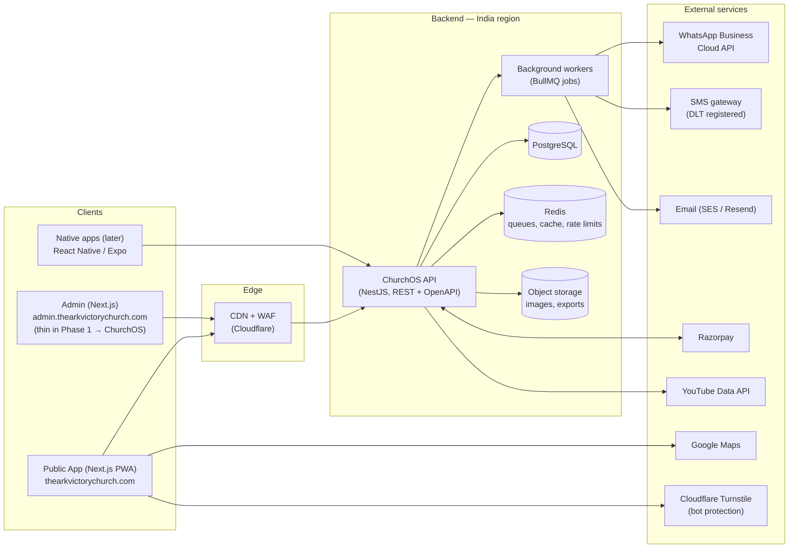
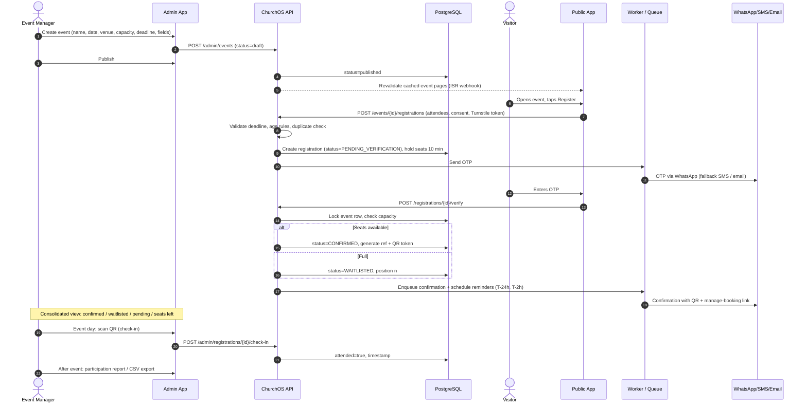
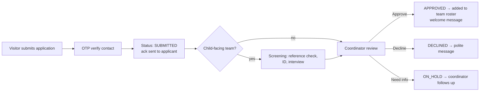
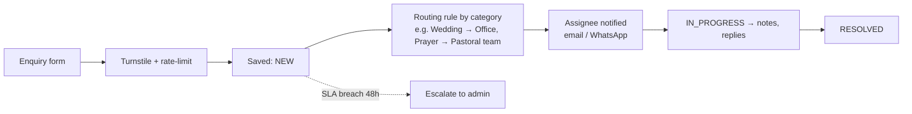
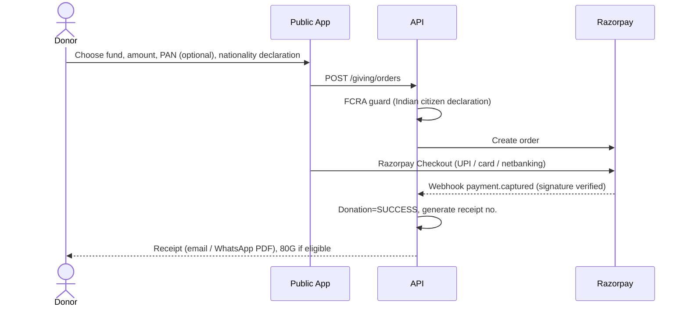
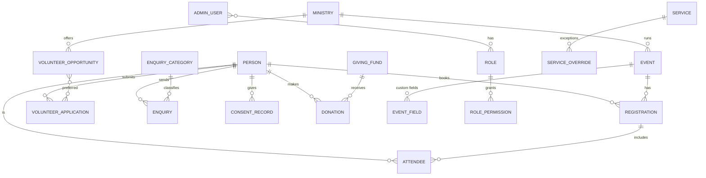

# The Ark — Public App: Architecture, Workflows & Build Plan

> Status: Long-range planning document. **Version 1 has been built in `ark-web/`.** Its as-built specification is `ark-web/docs/ARCHITECTURE.md`, which supersedes the stack choices below for v1 (single Next.js app instead of a separate NestJS API). ChurchOS Admin = Version 2.
> Scope: **Phase 1, the Public App**, designed from day one to plug into the future **ChurchOS Admin** back office described in `Ark.docx`.
> Date: 16 Nov 2026

---

## 0. TL;DR

| Question | Recommendation |
|---|---|
| Modify the existing WordPress site or build a new one? | **Build a new public app that eventually *replaces* the WordPress site** on the same domain. Keep WordPress live until the new app is ready, then cut over with 301 redirects. (Reasons in §2.) |
| What kind of "app"? | A **mobile-first web app installable as a PWA** (Progressive Web App). It works on every phone with no app-store approval. Native iOS/Android apps can come later and reuse the same API. |
| Tech stack | **Next.js (TypeScript)** for the public app, a separate **API service (NestJS)**, **PostgreSQL**, hosted in an **India region** (Mumbai). Use WhatsApp, SMS and email for notifications and **Razorpay (UPI)** for giving. |
| What must ship with Phase 1? | The 8 public features **plus a "thin admin"** (events, registrations, volunteer applications, enquiries, content). Without it nobody can run the public app, and it becomes the seed of ChurchOS Admin. |
| Logins for the public? | **None needed.** Event registration is guest-based and verified by phone or email. Optional accounts can be added later (as the doc says). |

---

## 1. Current State (what exists today)

Observed on https://thearkvictorychurch.com:

- **Platform:** WordPress, inferred from the `/wp-content/uploads/` paths and an image-optimisation plugin.
- **Pages:** Home, About (Mission, Gallery), Our Journey (Different Ministries), Services (Other Services), Givings (Reach out in faith, Live worship), Contact.
- **Sunday services:** 6 AM Bilingual, 8 AM Tamil (streamed), 10 AM English (streamed), 12:15 PM Ark Arise (youth), 5 PM Hindi Church, 5 PM Telugu Fellowship, International/African Fellowship on the 2nd Sunday.
- **Ministries:** Victory Kids (3–12), Tweens Church, Ark Arise (Sparkz, Life Fests, Tribe Night, camps), Hindi Church, Telugu Fellowship, International Fellowship, Rakshak (NGO, rakshak.org.in).
- **Contact:** phone, email (infovci@…) and the Sembakkam, Chennai address.
- **Integrations:** YouTube live, Instagram, Facebook.
- **Gaps:**
  - No forms
  - No event listings or registration
  - No online giving ("Donate" links to Contact)
  - No embedded map
  - Inconsistent content (Hindi service time, "African" vs "International" Fellowship naming, anniversary years)

**Conclusion:** the current site is a **static brochure**. None of the Phase 1 features (registrations, volunteer applications, enquiries, giving) exist yet, and none of the site's data is structured.

---

## 2. Decision: Modify WordPress vs. Build New

### Options considered

| | A. Extend WordPress | B. New app + keep WordPress (two sites) | **C. New app that replaces WordPress (recommended)** |
|---|---|---|---|
| Speed to first release | Fastest for simple forms | Medium | Medium |
| Connecting to ChurchOS Admin | Poor: data lives in WP tables and plugins, so it needs sync or webhooks | Good | **Best: one database, one source of truth** |
| Content duplication | n/a | **Bad:** service times and events are kept in two places and drift apart | None |
| Event capacity, waitlists, QR check-in, WhatsApp | Many paid plugins stitched together | Native | Native |
| Security of personal data (children, prayer, giving) | Plugin attack surface, hard to audit | Good | Good |
| AI assistant later ("how many registered for Ark Arise?") | Very hard | Possible | **Natural**, because all data is structured in Postgres |
| Multilingual (EN/TA/HI/TE) | Plugin (WPML, paid) | Native i18n | Native i18n |
| Long-term cost and maintainability | Plugin licences and update churn | Two stacks to maintain | One stack |

### Why C

1. The doc's core idea is that **the website and the back office are one system** ("Registration enters ChurchOS → admin gets consolidated view → automated communication → attendance → report"). This only works cleanly if the public app reads from and writes to the same database as the admin.
2. Running two sites (Option B) means service timings, ministries and events get edited in two places. They *will* drift; the current site already has inconsistencies.
3. The existing site has little to preserve: about 10 content pages and a gallery. Migrating them is a few days of work.

### How to do C safely

- Build the new app at **`new.thearkvictorychurch.com`** (staging/beta).
- Leave WordPress untouched at the main domain during development.
- At launch, point the main domain at the new app and **301-redirect every old WordPress URL** to its new equivalent, so Google rankings and shared links survive (see §12).
- Keep a WordPress backup and export for 6–12 months, then retire it.

> **If you need something live in the next 2–3 weeks**, a stop-gap is possible: add a single "Upcoming events" page to WordPress that links to the new app's registration pages. The new app still owns the data. Do **not** build registrations inside WordPress.

---

## 3. Users & Roles (Phase 1)

| Actor | Access | Needs |
|---|---|---|
| Visitor / Member (public) | No login | Find service times and location, learn about ministries, register for events, volunteer, contact, give |
| Parent / Guardian | No login | Register children for kids or youth events with consent |
| Super Admin | Thin admin | Users, roles, settings |
| Content Editor (Comms team) | Thin admin | Edit services, ministries, pages, gallery, announcements |
| Event Manager | Thin admin | Create events and see/export registrations; check-in |
| Volunteer Coordinator | Thin admin | Review and approve volunteer applications |
| Enquiry Handler (Office) | Thin admin | Respond to and route enquiries |
| Finance Viewer | Thin admin | View donations (only if online giving is enabled) |
| Ministry Leader | Thin admin, scoped | See only *their* ministry's events and volunteers |

**RBAC from day one.** Permissions are attached to roles, and roles can be **scoped to a ministry**. This is the same model ChurchOS Admin will need.

---

## 4. Feature Specification (Public App)

### 4.1 Church Information
- Home page:
  - Hero banner
  - "Next service" card (computed from the service schedule, e.g. "Tamil Service starts in 2h 15m")
  - Watch Live (YouTube)
  - Upcoming events strip
  - Plan-a-visit call to action
- About:
  - Mission and vision
  - History / journey (21 years)
  - Leadership (pastors)
  - Statement of faith
  - Gallery
- Plan Your Visit: address, embedded map, directions, parking, what to expect, kids check-in info, accessibility.
- Watch Live / Sermons: embedded YouTube live and a recent sermons playlist. This is pulled from the YouTube Data API or entered manually.
- Language switcher: **English · தமிழ் · हिन्दी · తెలుగు**.

### 4.2 Service Timings
- Structured, not free text: day, start/end time, language, venue/hall, livestream flag and recurrence (weekly, or nth Sunday for the International Fellowship).
- Views: "This Sunday" list and filter by language.
- **Add to calendar** (`.ics` and Google Calendar link).
- Special services (Christmas, Good Friday, Watch Night) override the regular schedule for a date.
- Holiday or cancellation banners.

### 4.3 Ministry Details
- Ministry list and detail pages: description, age group, meeting time, leader (optional), photos, related events, "Get involved" (links to a volunteer opportunity) and "Contact this ministry" (an enquiry pre-routed to the ministry).
- Seed list: Victory Kids, Tweens Church, Ark Arise, Hindi Church, Telugu Fellowship, International Fellowship, Rakshak (linking out to rakshak.org.in), plus Worship, Media, Ushering, Prayer and others as needed.

### 4.4 Upcoming Events
- List and calendar views. Filter by ministry, language and date.
- Event detail: banner, description, date/time, venue (with map), ministry, age restriction, price (free/paid), capacity indicator ("42 seats left" or "Waitlist open"), registration deadline, share buttons (WhatsApp first), add to calendar.
- Recurring events, e.g. a monthly Tribe Night.
- SEO: `Event` structured data (schema.org) so events show up in Google.

### 4.5 Event Registrations (most important workflow — see §6.1)
- Guest registration with no account. Fields: name, mobile (with country code), email, and optional custom fields per event (age, T-shirt size, dietary needs, church/branch, "how did you hear").
- **Group or family registration:** one person registers several attendees, including children.
- **Minors:** if an attendee is under 18, parent/guardian details and consent are required.
- Capacity, automatic waitlist, and deadline enforcement.
- **Verification:** OTP to mobile (WhatsApp/SMS) or email before the booking is confirmed. This stops spam and fake bookings.
- Confirmation with a **booking reference and QR code** (on-screen, WhatsApp and email).
- Self-service "Manage my booking" through a magic link: view, cancel, or add to calendar.
- Paid events (e.g. camps) collect payment through Razorpay at registration. This can be Phase 1b.
- Reminders at 24h and 2h before the event.

### 4.6 Volunteer Applications
- Volunteer opportunities list (team, description, commitment, requirements).
- Application form: personal details, team preferences (multi-select), availability (which service, which Sundays), skills, how long attending The Ark, home church, pastor reference, consent.
- **Child-facing teams** (Victory Kids, Tweens, Ark Arise) flag the application for extra screening: reference check, ID, interview.
- The applicant receives an acknowledgement and a status update when it is approved or declined.

### 4.7 Contact & Enquiries
- Contact page: phone, WhatsApp click-to-chat, email, address, map, office hours, social links.
- Enquiry form with categories:
  - General
  - New here / Plan a visit
  - Baptism
  - Wedding
  - Child dedication
  - Counselling
  - Prayer request
  - Rakshak / outreach
  - Media / press
  - Giving query
- Each category is **routed** to a team or person (configurable), with an SLA timer.
- **Prayer requests are sensitive.** They have an "only pastors may see" option and a "may we contact you?" toggle, and they are stored with restricted access.

### 4.8 Giving Information
- **Phase 1a (information only, no payments):**
  - Why we give
  - Funds (Tithes, Offerings, Building, Missions, Rakshak)
  - Bank transfer details
  - **UPI QR code** and UPI ID
  - Note on tax receipts
  - FAQ
- **Phase 1b (online giving):**
  - Razorpay checkout (UPI, cards, netbanking) with fund selection, amount, frequency (one-time or monthly through Razorpay Subscriptions) and PAN (needed for 80G)
  - Automatic receipt
- ⚠️ **Compliance — confirm with your CA before 1b:**
  - **80G receipts:** only if the church trust holds 80G registration. Receipts must include specific fields.
  - **FCRA:** donations from **foreign sources** (likely, given the International Fellowship and diaspora) may only be accepted into an FCRA-registered account. Online giving must **block or segregate foreign cards and foreign nationals** unless the trust has FCRA registration.
  - Online giving money flows to the trust's bank account. The app **never stores card or UPI details**.

---

## 5. System Architecture

### 5.1 High-level diagram



### 5.2 Why a separate API (and not just Next.js API routes)
- The **public app, admin, future native apps and the AI assistant** all consume the same API. Business rules (capacity, permissions, consent, audit) live in one place.
- The AI assistant (later) will call the **same permission-checked API endpoints as tools**. It must never get raw database access. Designing the API properly now makes that safe later.

### 5.3 Recommended stack

| Layer | Choice | Notes |
|---|---|---|
| Monorepo | **Turborepo + pnpm** | `apps/public`, `apps/admin`, `apps/api`, `packages/ui`, `packages/types`, `packages/config` |
| Public app | **Next.js (App Router) + TypeScript** | SSR/ISR for SEO and speed. PWA through a service worker. |
| Styling / UI | Tailwind CSS + shadcn/ui | Shared design system with the admin |
| i18n | `next-intl` | EN, TA, HI, TE. Translatable content stored per locale in the DB. |
| API | **NestJS + TypeScript** | Modules per domain. OpenAPI spec generates a typed client for the frontends. |
| ORM | Prisma (or Drizzle) | Migrations in git |
| Database | **PostgreSQL 16** | Managed: AWS RDS (ap-south-1), Neon or Supabase in an India region |
| Queue / cache | Redis + BullMQ | Notifications, reminders, exports |
| Storage | S3-compatible (AWS S3 Mumbai or Cloudflare R2) | Images resized through Next/Image or a CDN |
| Auth (admin only) | Auth.js (or Clerk) | Email and Google sign-in, **mandatory 2FA for admins** |
| Public verification | OTP via WhatsApp/SMS/email | No public accounts |
| Notifications | WhatsApp Cloud API (Meta, or a BSP such as Gupshup/Interakt), SMS via MSG91 or similar, email via Amazon SES or Resend | Indian SMS needs **DLT registration** of sender ID and templates. WhatsApp needs approved templates. |
| Payments | Razorpay | UPI first. Webhooks for confirmation. |
| Bot protection | Cloudflare Turnstile | On every public form |
| Hosting | Frontends on **Vercel** (or AWS Amplify). API and workers on **AWS (ECS Fargate / App Runner)**, Railway or Render. | Keep the DB and API in India for latency and DPDP comfort. |
| Monitoring | Sentry (errors), Better Stack / UptimeRobot (uptime), Plausible or GA4 (analytics) | |
| CI/CD | GitHub Actions | Lint, test, preview deploys, migrations |

> **Simpler alternative** if the team is 1–2 people: Next.js + **Supabase** (Postgres, auth, storage and row-level security) and drop NestJS. It is faster to build but harder to grow into the AI-assistant and admin vision. The modular API is still recommended because ChurchOS is clearly the long-term goal.

### 5.4 API module layout (`apps/api/src/modules`)

```
content/        pages, blocks, gallery, announcements, translations
services/       service schedule, special services, overrides
ministries/     ministries, leaders
events/         events, sessions, custom form fields, capacity
registrations/  registrations, attendees, waitlist, check-in, QR
volunteers/     opportunities, applications, screening
enquiries/      enquiries, categories, routing rules, notes
giving/         funds, giving info, donations (1b), receipts, webhooks
people/         unified person/contact records + de-duplication
consent/        consent records (DPDP)
notifications/  templates, channels, outbox, delivery logs
media/          uploads, image variants
auth/ rbac/     admin users, roles, permissions, ministry scopes
audit/          audit log of every admin write
```

---

## 6. Core Workflows

### 6.1 Event registration (the "Ark Arise" example from the doc)



**Registration state machine**

```
PENDING_VERIFICATION ──verify──▶ CONFIRMED ──check-in──▶ ATTENDED
        │                          │   ▲
        │ (10 min timeout)          │   │ seat freed → auto-promote
        ▼                          ▼   │
     EXPIRED                    CANCELLED   WAITLISTED ──promote──▶ CONFIRMED
                                                 (notify; 24h to accept, optional)
CONFIRMED ──event ends, not checked in──▶ NO_SHOW
```

**Rules**
- **Capacity correctness:** confirm seats inside a DB transaction with a row lock (`SELECT … FOR UPDATE`) on the event, or with a counter guarded by a constraint. This prevents overbooking when 200 youths register at the same moment.
- **Duplicates:** the same mobile number for the same event triggers a prompt: "You've already registered — resend confirmation?"
- **Minors:** attendees under 18 require guardian name, mobile and a consent checkbox. The consent is stored as a `ConsentRecord`.
- **Cancellation** by the visitor (magic link) or an admin frees the seat and **auto-promotes** the first waitlisted person.
- **Paid events (1b):** PENDING_PAYMENT, then Razorpay checkout. A webhook moves the booking to CONFIRMED. The seat hold expires after 15 minutes.

### 6.2 Volunteer application



- Coordinators only see applications for the teams they are scoped to.
- Phase 2 (ChurchOS): approved volunteers flow into **Volunteers, Teams, Schedules and Assignments**.

### 6.3 Contact & enquiry



- **Prayer requests:** visibility is restricted to the Pastoral role. They are never included in general exports and are never sent through the AI assistant without permission.
- An auto-acknowledgement goes to the sender: "Thanks, someone from our team will reach out within 2 working days."

### 6.4 Content management (thin admin)
- Editors update services, ministries, pages, the gallery and announcements in the admin.
- Publishing triggers **on-demand revalidation** of the affected public pages, so changes appear within seconds.
- Content is stored per locale. A missing translation falls back to English.

### 6.5 Giving (Phase 1b)



---

## 7. Data Model (Phase 1)



### Key tables (fields abbreviated)

| Table | Key fields |
|---|---|
| `person` | id, full_name, mobile_e164 (indexed), email, dob?, gender?, preferred_language, source, created_at. *One record per human, de-duplicated by verified mobile or email. This becomes the member directory in ChurchOS.* |
| `consent_record` | person_id, purpose (`event_registration`, `whatsapp_updates`, `child_participation`, `photo_usage`), granted, text_version, ip, timestamp, withdrawn_at |
| `service` | id, name{locale}, language, day_of_week, start_time, end_time, recurrence_rule (RRULE), venue, is_livestreamed, youtube_url, sort_order, active |
| `service_override` | service_id?, date, type (cancel/special/time_change), note{locale} |
| `ministry` | id, slug, name{locale}, summary{locale}, body{locale}, age_min, age_max, meeting_info, leader_name, contact_email, cover_image, active |
| `event` | id, slug, ministry_id, title{locale}, description{locale}, starts_at, ends_at, timezone, venue, map_url, capacity, waitlist_enabled, reg_opens_at, reg_closes_at, min_age, max_age, price_paise, status (draft/published/cancelled/completed), banner, recurrence_rule? |
| `event_field` | event_id, key, label{locale}, type (text/select/number/checkbox), options, required, per_attendee |
| `registration` | id, ref_code (e.g. `ARK-7Q4K2`), event_id, booker_person_id, status, verified_at, waitlist_position, qr_token_hash, payment_id?, cancel_token_hash, created_at |
| `attendee` | registration_id, person_id, is_minor, guardian_person_id?, answers JSONB, checked_in_at |
| `volunteer_opportunity` | id, ministry_id, title{locale}, description, commitment, requires_screening, active |
| `volunteer_application` | id, person_id, preferences[], availability JSONB, skills, attending_since, reference_name/phone, status, screening_status, reviewer_id, notes |
| `enquiry_category` | id, name{locale}, route_to_role/user, sla_hours, is_sensitive |
| `enquiry` | id, person_id, category_id, subject, message, contact_ok, status, assignee_id, is_sensitive, resolved_at |
| `giving_fund` | id, name{locale}, description, upi_id, bank_details, active, is_80g_eligible |
| `donation` (1b) | id, person_id, fund_id, amount_paise, currency, razorpay_order_id, razorpay_payment_id, status, pan_encrypted, receipt_no, is_indian_citizen_declared |
| `notification_outbox` | id, channel, template, to, payload, status, attempts, provider_msg_id, sent_at |
| `admin_user`, `role`, `permission`, `role_permission`, `user_role(scope_ministry_id?)` | RBAC |
| `audit_log` | actor_id, action, entity, entity_id, before JSONB, after JSONB, ip, at |
| `page`, `content_block`, `media`, `announcement` | CMS |

**Conventions:**
- UUID primary keys
- `created_at`/`updated_at` on every table
- Soft-delete (`deleted_at`) for people data
- Money stored in **paise as integers**
- Timestamps in UTC, displayed in `Asia/Kolkata`
- Translatable fields stored as JSONB, e.g. `{ "en": "...", "ta": "...", "hi": "...", "te": "..." }`

---

## 8. API Design (Public endpoints, v1)

All endpoints are under `/api/v1`. They return JSON, use cursor pagination, and are described in an OpenAPI spec.

| Method & path | Purpose | Notes |
|---|---|---|
| `GET /services?locale=` | Service schedule and upcoming overrides | Cached 5 min |
| `GET /services/next` | Next upcoming service | |
| `GET /ministries`, `GET /ministries/{slug}` | Ministries | |
| `GET /events?ministry=&from=&to=&lang=` | Upcoming events | |
| `GET /events/{slug}` | Event detail and live seats left | Seats left not cached |
| `POST /events/{id}/registrations` | Start a registration | Turnstile, rate limit, idempotency key |
| `POST /registrations/{id}/verify` | Submit OTP | Max 5 attempts |
| `POST /registrations/{id}/resend-otp` | Resend OTP | Throttled |
| `GET /bookings/{token}` | Manage booking (magic link) | |
| `POST /bookings/{token}/cancel` | Cancel booking | |
| `GET /bookings/{token}/ics` | Calendar file | |
| `GET /volunteer-opportunities` | Volunteer opportunities | |
| `POST /volunteer-applications` (+ verify) | Submit volunteer application | |
| `GET /enquiry-categories`, `POST /enquiries` | Contact and enquiries | |
| `GET /giving/funds` | Giving info, UPI, bank details | |
| `POST /giving/orders` (1b) | Create Razorpay order | |
| `POST /webhooks/razorpay` | Payment webhook | Signature verified |
| `POST /webhooks/whatsapp` | Delivery status and inbound "STOP" | |
| `GET /content/pages/{slug}` | CMS pages | |

The admin endpoints (`/api/v1/admin/...`) mirror these with CRUD, exports and check-in, and are all permission-checked and audit-logged.

---

## 9. Public App — Sitemap & Screens

```
/                         Home
/visit                    Plan your visit (map, what to expect, kids)
/services                 Service timings (+ filter by language)
/watch                    Live & sermons (YouTube)
/ministries               Ministries list
/ministries/[slug]        Ministry detail
/events                   Events (list / calendar)
/events/[slug]            Event detail
/events/[slug]/register   Registration flow (multi-step)
/booking/[token]          Manage my booking
/volunteer                Opportunities
/volunteer/apply          Application form
/contact                  Contact + enquiry form
/prayer                   Prayer request (sensitive enquiry)
/give                     Giving information (+ online giving in 1b)
/about, /about/journey, /about/leadership, /gallery
/privacy, /terms, /consent
/[locale]/...             ta | hi | te versions
```

**Mobile-first UX notes**
- Bottom navigation in PWA mode: **Home · Services · Events · Give · More**.
- One-tap actions: Call, WhatsApp, Directions, Watch Live, Add to calendar, Share on WhatsApp.
- Registration in at most 3 steps: Attendees, then Details and consent, then Verify.
- Works on low-end Android over 3G/4G: Lighthouse performance of 90 or more, images under 200 KB, offline fallback page showing cached service times.
- Accessibility: WCAG 2.1 AA, large tap targets, sufficient contrast, and Indic fonts (Noto Sans Tamil, Devanagari and Telugu).

---

## 10. Thin Admin (ships with Phase 1)

| Screen | Capability |
|---|---|
| Dashboard | Upcoming events with seats filled, new enquiries, pending volunteer applications |
| Events | Create, edit, publish or cancel. Custom fields. Duplicate an event. |
| Registrations | Filter, search, export CSV, manual add, cancel, promote from waitlist, **QR check-in (phone camera)**, message all attendees |
| Volunteers | Applications queue, screening checklist, approve or decline |
| Enquiries | Inbox by category, assign, notes, resolve, SLA indicators |
| Content | Services and overrides, ministries, pages, gallery, announcements, translations |
| Giving | Fund info. Donations list and receipts (1b, Finance role only). |
| Settings | Users and roles, routing rules, notification templates, church profile |
| Audit log | Who changed what, and when |

This *is* ChurchOS Admin v0. Phase 2 adds the modules from the doc: Pastoral Care, Children & Youth, Finance, Communication, Reports and the AI Assistant.

---

## 11. Security, Privacy & Compliance

### India's DPDP Act 2023 (Digital Personal Data Protection)
- **Purpose-specific consent:** separate checkboxes for registration, WhatsApp updates and photo usage. Consent records are stored together with the exact consent text version.
- **Children (<18):** the Act requires **verifiable parental consent**. Collect guardian details and consent for every minor attendee. No tracking or marketing aimed at minors.
- Privacy notice in all four languages. Provide a process for data access, correction and erasure requests, and name a contact for grievances.
- **Data minimisation:** don't collect what you don't use (e.g. no DOB unless the event needs age).
- **Retention:** e.g. delete or anonymise unverified registrations after 30 days and enquiries after 2 years, configurable.
- Breach response plan.

### Application security
- HTTPS everywhere, HSTS, CSP, and Cloudflare WAF.
- Turnstile, rate limiting (Redis) and idempotency keys on all public POSTs.
- OTP: 6 digits, 5-minute expiry, at most 5 attempts, hashed at rest.
- Magic-link and QR tokens are random (at least 128-bit), stored **hashed**, and scoped to one booking.
- Admin: SSO or email login with **mandatory 2FA**, short sessions, IP and device logging.
- **RBAC and ministry scoping enforced in the API**, not just hidden in the UI.
- Sensitive fields (PAN, prayer request text) are encrypted at column level.
- Every admin write goes to `audit_log`.
- Daily encrypted DB backups with point-in-time recovery. Test a restore every quarter.
- Dependency scanning (Dependabot) and secrets in a vault or environment variables, never in git.
- Payments: Razorpay Checkout, so the app is never in PCI scope. Always verify webhook signatures.

### Messaging compliance (India)
- **SMS:** register the entity, sender ID ("ARKVCH" or similar) and every template on a **DLT** portal. This takes 1–2 weeks, so start early.
- **WhatsApp:** get a verified Business account and pre-approved templates (OTP, confirmation, reminder, waitlist promotion, volunteer status). Users must opt in, and "STOP" must be honoured.

---

## 12. Migration from WordPress & SEO

1. **Inventory** every WordPress URL (sitemap.xml, Google Search Console).
2. **Migrate content:** pages, gallery images and mission text. Clean up the inconsistencies (Hindi service time, Fellowship naming, anniversary years) with leadership sign-off.
3. **Redirect map:** add 301s in Next.js `redirects()` for every old path, e.g. `/different-ministries/` → `/ministries`, `/other-services/` → `/services`, `/contact-us/` → `/contact`.
4. Generate `sitemap.xml` and `robots.txt`. Add structured data: `Church` / `PlaceOfWorship`, `Event`, `Organization`.
5. Update the **Google Business Profile** (service times and link), YouTube channel links, and Instagram/Facebook bio links.
6. **DNS cutover** at low traffic (a weekday). Keep WordPress on a hidden subdomain for 30 days as a fallback.
7. Monitor 404s in Search Console for 4 weeks.

---

## 13. Development Workflow

### Repository structure

```
ark/
├─ apps/
│  ├─ public/        # Next.js public PWA
│  ├─ admin/         # Next.js admin (thin → ChurchOS)
│  └─ api/           # NestJS API + workers
├─ packages/
│  ├─ ui/            # shared components (shadcn/Tailwind)
│  ├─ api-client/    # generated from OpenAPI
│  ├─ types/         # shared zod schemas & types
│  └─ config/        # eslint, tsconfig, tailwind presets
├─ infra/            # IaC (Terraform / Pulumi), docker-compose for local
├─ docs/             # this file, ADRs, runbooks
└─ .github/workflows/
```

### Environments
- `local`: docker-compose (Postgres, Redis, Mailpit), seed data.
- `preview`: a deploy for every pull request (Vercel previews against a shared staging API).
- `staging`: `new.thearkvictorychurch.com` / `staging-admin…`, with production-like data that is **anonymised**.
- `production`

### Git and CI
- Trunk-based: short-lived feature branches and pull requests into `main`, with at least one review.
- CI runs lint, type-check, unit tests, API integration tests (Testcontainers Postgres), Playwright end-to-end tests on critical flows (register, verify, confirm; volunteer apply; enquiry) and a Lighthouse budget.
- DB migrations run automatically on deploy and must be backward-compatible (expand, then contract).
- Conventional commits and an automated changelog.
- Record significant decisions as **ADRs** in `docs/adr/` (e.g. "ADR-001: Replace WordPress with Next.js").

### Testing priorities
1. Capacity and concurrency: load-test 300 simultaneous registrations for one 100-seat event. The result must be exactly 100 confirmed and the rest waitlisted.
2. OTP and magic-link security.
3. RBAC: a ministry leader must not see another ministry's data.
4. i18n rendering in all four languages, including Indic font rendering on Android.
5. Payment webhooks: idempotency, and duplicate or out-of-order delivery.

---

## 14. Delivery Plan (indicative)

Assumes 2–3 developers plus 1 designer part-time. Each sprint is 2 weeks.

| Sprint | Deliverables |
|---|---|
| **0 — Foundations** (1–2 wks) | Content audit with leadership, branding, wireframes. Start **DLT, WhatsApp Business and Razorpay KYC** (long lead times). Get CA advice on 80G and FCRA. Set up the repo, CI and environments. |
| **1** | Design system, layout, i18n scaffolding. Data model and migrations. Admin auth and RBAC. |
| **2** | Services, ministries, pages and gallery (public and admin CMS). Home page, Plan a Visit, Watch Live. |
| **3** | Events: admin CRUD, public list and detail, calendar, `.ics`. |
| **4** | **Registrations:** OTP, capacity, waitlist, confirmations, reminders, manage booking, QR check-in, exports. |
| **5** | Volunteer applications and enquiries (routing, SLA, prayer privacy). Giving info page with UPI QR. |
| **6** | PWA (install, offline), SEO and structured data, accessibility, performance. Translation pass. Security review. Load test. |
| **7 — Launch** | Content migration, redirect map, UAT with staff, **soft launch on `new.` subdomain** with one real event (e.g. an Ark Arise night), then DNS cutover. |
| **1b** (+2–3 wks) | Online giving through Razorpay, receipts, paid events. |

**Approximate Phase 1 timeline: 14–16 weeks.** A smaller MVP (services, ministries, events and registration, contact) is achievable in about 8 weeks.

### Definition of Done (Phase 1)
- An admin can create the Ark Arise event, and visitors can register, verify, and receive a WhatsApp/email confirmation with a QR code.
- The admin can see a consolidated view, check people in on the day, and export a participation report. *(This is the exact workflow in the doc.)*
- All public pages are available in EN/TA/HI/TE with Lighthouse scores of 90 or more on mobile.
- Every old WordPress URL redirects correctly.

---

## 15. Running Cost (rough, monthly, check current pricing)

| Item | Estimate |
|---|---|
| Hosting: frontends, API, Postgres, Redis, storage | ~₹2,500 – ₹10,000 depending on provider and tier |
| Domain / Cloudflare | Free – low |
| Email (SES) | Very low (cents per thousand) |
| SMS (OTP, DLT) | Per-message pricing, roughly paise per SMS |
| WhatsApp Business | Per-conversation pricing set by Meta (utility and authentication categories), plus BSP fee if one is used |
| Razorpay | Per-transaction fee (UPI pricing may differ). Ask about non-profit rates. |
| Sentry / uptime / analytics | Free tiers usually suffice |

---

## 16. Path to ChurchOS Admin (Phase 2+) — why this design fits

| ChurchOS module (from doc) | Built on Phase 1 foundation |
|---|---|
| Ministries | `ministry` table and ministry-scoped RBAC |
| Pastoral Care | `enquiry` (prayer, counselling) with the sensitive flag; add follow-ups |
| Volunteers | `volunteer_application`, then teams, schedules and assignments |
| Children & Youth | `attendee.is_minor`, guardian links and consent records; add groups and attendance |
| Giving / Finance | `giving_fund`, `donation` and receipts; add expenses and reconciliation |
| Communication | `notification_outbox`, templates and channels; add announcements and segments |
| Reports | Event participation, registrations and donations; add dashboards |
| **AI Assistant** | Calls the **same permission-checked API** as tools: "How many registered for Ark Arise?" maps to `GET /admin/events/{id}/stats`. Write actions (send a reminder, record a finance entry) **always require explicit human confirmation** and are audit-logged, as the doc requires. |
| Settings | Users, roles, permissions and configuration already exist |

Optional public **member accounts** (giving history, saved family members, one-tap registration) can be added later on top of the existing `person` table, with no redesign.

---

## 17. Open Questions for Leadership

1. **Ownership:** who signs off on content, and who is the data protection contact?
2. **Domain plan:** OK to replace the WordPress site at launch? Who has the DNS and hosting credentials?
3. **Languages:** are all four languages needed at launch, or English and Tamil first?
4. **Giving:** does the trust hold **80G** and/or **FCRA** registration? Which bank account should receive online giving?
5. **WhatsApp:** is there an existing WhatsApp Business number to use for official messages?
6. **Child safety policy:** what screening is required for volunteers on child-facing teams?
7. **Events:** are paid events (camps) needed in the first release?
8. **Rakshak:** stay a separate site (rakshak.org.in) with a link, or be included in this platform?
9. **Branches:** are there other campuses or branches now or planned? (If so, add `campus_id` to the model now; it is cheap now and expensive later.)
10. **Team:** in-house developers, volunteers, or an agency? This affects whether to use the full stack (§5.3) or the Supabase simplification.
