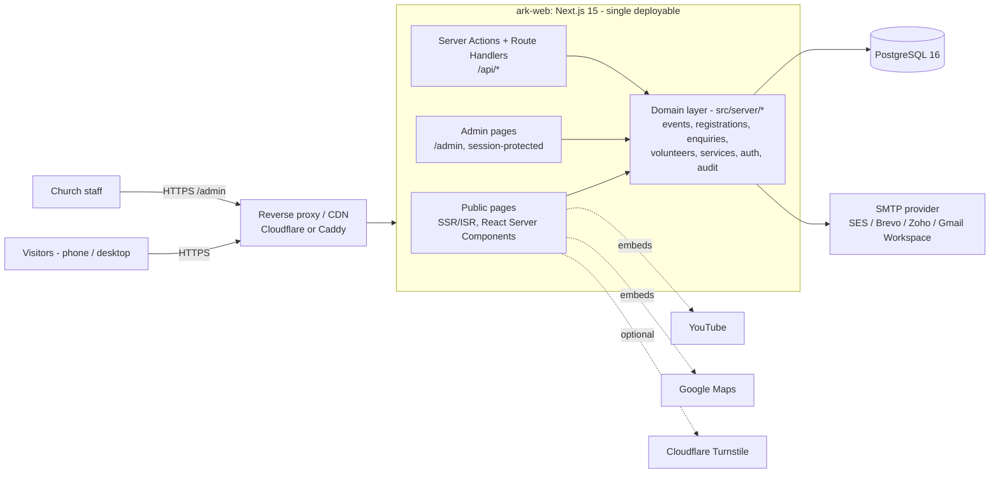
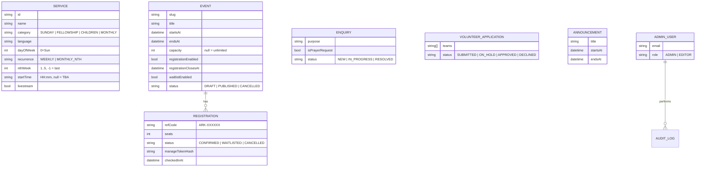
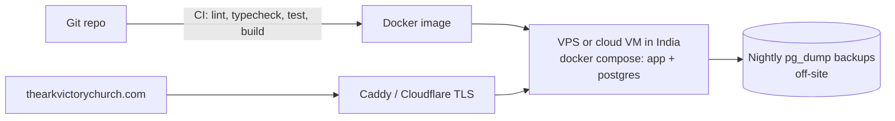

# The Ark Victory Church — Public Web App (Version 1)

> **Version 1:** the new public website and app. It replaces the WordPress site at thearkvictorychurch.com.
> **Version 2 (later):** ChurchOS Admin, the full back office (pastoral care, finance, children and youth, AI assistant). Version 1 is shaped so that Version 2 can grow out of it. Version 1 does **not** implement ChurchOS.
>
> `../ARK_PUBLIC_APP_ARCHITECTURE.md` is the longer-range planning document. **This file is the build specification that the code in this repository follows.**

---

## 1. Goals and non-goals

### Goals (v1)
1. **Full content parity with WordPress.** Every piece of information on the 12 WordPress pages is carried over: text, service times, ministries, the journey timeline, mission and Petras/Rakshak, the giving QR, contacts, social links and gallery. Nothing is dropped. (See §9 and `docs/CONTENT_INVENTORY.md`.)
2. **Mobile-first, fast, installable (PWA).** The site should feel like an app on a phone.
3. **Dynamic, admin-editable data** for the things that change week to week:
   - Service timings
   - Events
   - Announcements
4. **The public workflows that WordPress didn't have:**
   - Event registration, with capacity limits, a waitlist, a QR ticket, manage/cancel and an `.ics` calendar file
   - Volunteer applications
   - Contact, enquiries and prayer requests, saved to a database (not just emailed)
5. **A small, secure admin area** at `/admin` for staff to manage the above.
6. **Keep SEO and links working.** Every old WordPress URL 301-redirects to its new page.

### Non-goals (deferred to v1.x / v2)
- **Online payments:** v1 shows the existing *Victory Churches of India* QR / POS details, just as the WordPress site does.
- **Languages:** WhatsApp/SMS messages and Tamil/Hindi/Telugu translations are not in v1. The UI is English, like the current site, with i18n-ready structure.
- **Accounts:** no public member accounts and no ChurchOS modules (finance, pastoral care, children check-in, AI assistant).

---

## 2. Architecture



### Why a single Next.js app for v1 (ADR-001)
- One deployable, one database. Easy for a small church team to run.
- All business rules live in **`src/server/*`**, which is a framework-agnostic domain layer. Pages and actions only call into it. In v2 this layer can be lifted into a standalone ChurchOS API without rewriting the rules.
- The Postgres schema already uses the ChurchOS naming (events, registrations, enquiries, volunteer applications, audit log), so v2 *extends* it rather than migrating away from it.

### Stack
| Concern | Choice |
|---|---|
| Framework | Next.js 15 (App Router, React 19, TypeScript strict) |
| Styling | Tailwind CSS v4, custom design tokens (navy/blue brand from the current site) |
| Database | PostgreSQL 16 via Prisma ORM 6 (versioned migrations) |
| Validation | Zod, shared by client and server |
| Admin auth | Email + password (bcrypt, cost 12), HS256-signed JWT in an httpOnly cookie, 8-hour session, login rate limiting |
| Email | Nodemailer over SMTP. Falls back to console logging when SMTP is not configured (dev). |
| Bot protection | Honeypot field and per-IP rate limits on every public form. Cloudflare Turnstile when its keys are set. |
| QR / calendar | `qrcode` for tickets; `.ics` files generated in-house (RFC 5545) |
| Images | Legacy images re-encoded to WebP (max 1920px) in `public/images`; served through `next/image` |
| Packaging | Docker (Next `standalone` output) + `docker-compose.yml` (app + Postgres) |
| Tests | Vitest (domain logic, validation, ICS, time maths) |

---

## 3. Domain model



**Editable content (Admin → Page content).**
- **Defaults** for every text section live in typed files (`src/content/*.ts`).
- When staff save a section, it is stored in the `content_block` table and overrides the default; `getSection()` in `src/server/content.ts` merges the saved value over the default.
- **The editor is generated** from each section's shape (`src/lib/content-schema.ts`). The same shape drives server-side Zod validation:
  - required fields
  - safe links only (`/path`, `https:`, `mailto:`, `tel:`)
  - images limited to `/images/*` or `/media/*`
  - unique ministry slugs
  - unknown fields are stripped
- **History:** every save keeps the previous version in `content_revision` (the last 30), with restore and reset-to-original.
- **Uploads:** stored in the `media` table and served from `/media/<id>.webp`, so it works on any host, including serverless. Uploads are re-encoded with sharp: maximum 2000 px, WebP, and all EXIF/GPS metadata stripped.
- **Fallback:** if a stored section ever fails validation, for example after a code change, the site falls back to the default rather than breaking.

---

## 4. Key workflows

### 4.1 Event registration
```mermaid
sequenceDiagram
  actor V as Visitor
  participant P as /events/[slug]/register
  participant D as registrations.register()
  participant DB as Postgres
  participant M as Mailer
  V->>P: name, email, phone, seats (1-10), consent
  P->>D: validated input (zod) + IP rate-limit + honeypot/Turnstile
  D->>DB: BEGIN; SELECT event FOR UPDATE
  D->>D: open? not past deadline? duplicate email?
  alt seats available
    D->>DB: INSERT registration CONFIRMED
  else full and waitlist on
    D->>DB: INSERT registration WAITLISTED
  else full
    D-->>P: "Event is full"
  end
  D->>DB: COMMIT
  D->>M: confirmation email (ref code, QR, manage link, .ics)
  P-->>V: confirmation page (ref + QR + add to calendar)
```
- **No overbooking.** Confirmed seats are counted *inside* the transaction while the event row is locked (`SELECT … FOR UPDATE`). Concurrent registrations are serialised per event.
- **Manage link.** The link `/booking/<token>` carries a 32-byte random token. Only its SHA-256 hash is stored. The page lets the visitor view the booking, download the `.ics` file or cancel.
- **Cancellation** (by the visitor or an admin) frees the seats and **promotes waitlisted registrations in FIFO order** while they fit. Each promoted person receives a promotion email.
- **Check-in.** The admin searches by reference code, name or phone (the QR encodes the reference code) and marks the registration attended.

### 4.2 Contact, enquiries and prayer
Each purpose keeps the WordPress form's options:
- Ministerial Opportunities
- Volunteer With Us
- Donate to the Building Fund
- Discipleship Groups

Added options:
- General enquiry
- New to Ark / plan a visit
- Prayer request
- Join a service/ministry

Every submission is saved and appears in the admin inbox (NEW, then IN_PROGRESS, then RESOLVED, with internal notes). The office email gets a notification and the sender gets an acknowledgement. Prayer requests are flagged and **excluded from notification email bodies**: the email says only that a request arrived, so its content stays inside the admin.

### 4.3 Volunteer application
The public form takes teams (multi-select), availability, attending-since, experience and consent. The application is SUBMITTED, then reviewed in the admin as ON_HOLD, APPROVED or DECLINED, with notes. The applicant is emailed on submit and on each decision.

### 4.4 Content operations
- Service timings, events and announcements are edited in `/admin`. The public pages read from the database and are revalidated on every change.
- Text pages are edited in `src/content/*` and deployed.

---

## 5. URL map (new site and legacy redirects)

| New route | Content | Old WordPress URL (301 →) |
|---|---|---|
| `/` | Home | `/`, `/home` |
| `/about` | About us, pastors, Ark team | `/about-us/` |
| `/about/mission` | Mission statement, missions, Petras & Rakshak, ministry teams | `/our-mission/` |
| `/about/journey` | 1999 → today timeline | `/our-journey/` |
| `/services` | Sunday services, language fellowships, children & youth | `/services/`, `/services-2/` |
| `/services/special` | Dawn service, night prayer, fasting, 7/21 days, Special Sundays | `/other-services/` |
| `/ministries` · `/ministries/[slug]` | All ministries | `/differentministries/` |
| `/events` · `/events/[slug]` · `/events/[slug]/register` | Events and registration | — (new) |
| `/booking/[token]` | Manage booking | — (new) |
| `/get-involved` · `/get-involved/volunteer` | Reach out in faith; volunteer form | `/get-in-touch/` |
| `/give` | Offering QR, building fund, Rakshak | `/givings/` |
| `/watch` | Live worship (YouTube) | `/live-worship/` |
| `/gallery` | Gallery | `/gallery/` |
| `/contact` | Contact, map, enquiry form | `/contact-us/`, `/contact us/`, `/Contact us/` |
| `/privacy` | Privacy notice (DPDP Act 2023) | — |
| `/admin/*` | Staff area | `/wp-admin`, `/wp-login.php` → 410 |

---

## 6. Security and privacy
- **Admin sessions:** httpOnly, `Secure`, `SameSite=Lax` cookie containing a signed JWT. Middleware gates `/admin/*`, and every admin action **re-verifies the session server-side**. Role checks: `ADMIN` manages users; `EDITOR` manages content and inboxes.
- **Passwords:** bcrypt with cost 12. Login is limited to 5 attempts per 15 minutes per IP and email.
- **Public forms:**
  - Zod validation and length limits
  - Honeypot field and per-IP rate limiting
  - Optional Turnstile
  - Server Actions are protected by Next's Origin check
- **Headers:** strict CSP (frame-src limited to YouTube, Google Maps and Turnstile), HSTS, `X-Content-Type-Options`, `Referrer-Policy`, `Permissions-Policy`, and `frame-ancestors 'none'`.
- **Data protection (DPDP Act 2023):**
  - **Consent:** explicit consent checkbox on every form, with the consent timestamp stored.
  - **Privacy notice:** a privacy page naming a grievance contact.
  - **Minimal data:** collect only what is used.
  - **Retention:** prayer requests visible only in the admin.
  - Retention job documented in `docs/OPERATIONS.md`.
- **Audit log:** every admin mutation is written to `audit_log`.
- **No secrets in git:** `.env.example` documents every variable.

---

## 7. Non-functional targets
- Lighthouse mobile ≥ 90 (performance, accessibility, best practices, SEO).
- WCAG 2.1 AA: semantic landmarks, focus states, alt text, contrast.
- SEO:
  - `metadata` on every page, Open Graph, `sitemap.xml`, `robots.txt`
  - JSON-LD `Church` (PlaceOfWorship) with opening hours, and `Event` structured data
- **PWA:**
  - Web manifest (icons incl. maskable, shortcuts, screenshots), iOS meta tags and safe-area support.
  - Service worker (`public/sw.js`):
    - Static assets are cache-first; images are stale-while-revalidate.
    - Public pages are network-first, with an offline fallback (`/offline`).
    - Home, Services, Events and Contact are pre-warmed so they work offline from day one.
    - `/admin`, `/api`, `/booking`, POSTs and RSC payloads are **never** cached.
  - Install prompt (Android/desktop) plus an "Add to Home Screen" hint on iOS.
  - An "Update available" toast when a new service worker is waiting, and an offline banner.
- Times stored in UTC and displayed in **Asia/Kolkata**.

---

## 8. Deployment


Also supported: Vercel for the app with a managed Postgres (Neon, Supabase or RDS Mumbai).

**Cutover:** go live at `new.thearkvictorychurch.com`, run UAT, switch DNS, and keep WordPress backed up for 30 days. Full runbook: `docs/OPERATIONS.md`.

---

## 9. Content parity checklist
Every section of the 12 legacy pages is mapped to a route in `docs/CONTENT_INVENTORY.md`. Where the legacy site **contradicted itself**, both facts are kept and the item is listed under "Needs confirmation" so church leadership can decide. Examples:
- The Dawn service is described as both "first day of the month" and "first Sunday".
- Rakshak is described as serving both "1000+" and "3,000+" children.

---

## 10. Path to v2 (ChurchOS)
| v1 asset | Becomes in v2 |
|---|---|
| `src/server/*` domain layer | ChurchOS API modules |
| `registration`, `enquiry`, `volunteer_application` | Events, Pastoral Care and Volunteers modules |
| `admin_user` + roles + `audit_log` | Settings / RBAC with ministry scopes |
| Email notifications | Communication module (WhatsApp/SMS channels added) |
| Static `src/content` | CMS tables (multilingual) |
